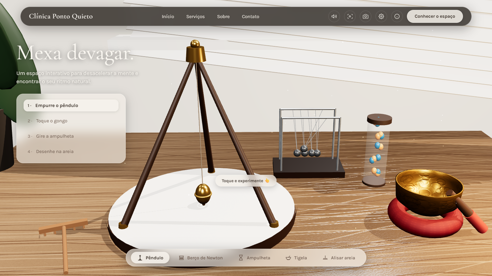
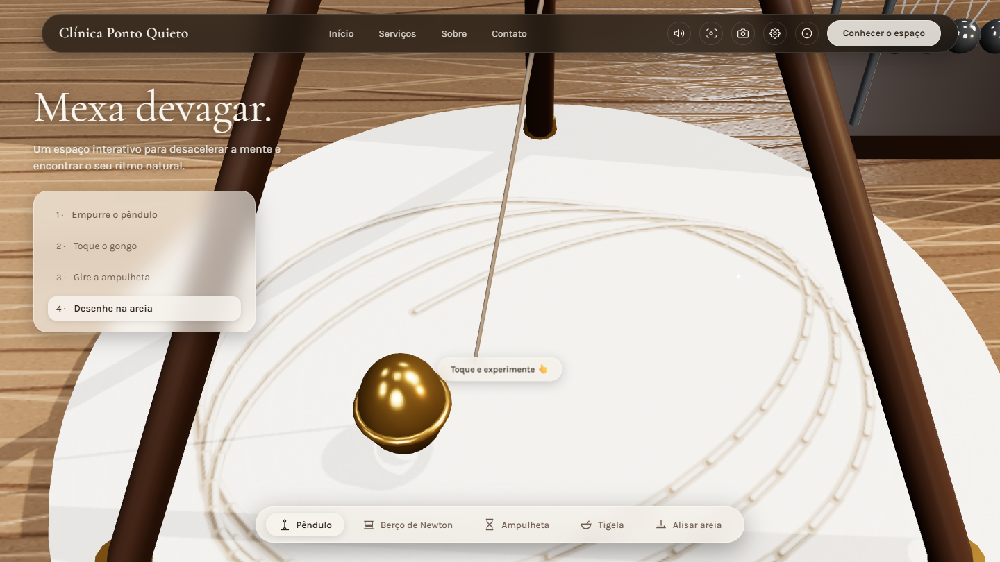
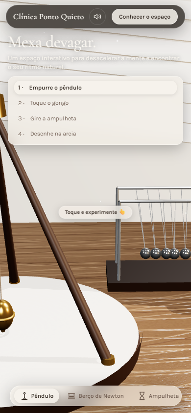

# Relatório de Verificação e Performance — 02. Mesa dos Objetos que Acalmam

Data da Verificação: 24 de Novembro de 2026  
Ambiente: Node.js v26.5.0, Three.js r160, Playwright Chromium Headless, Windows 11  
Arquivo Testado: [`mesa-dos-objetos-que-acalmam.html`](file:///c:/Users/aless/Downloads/Ambientes%203D/ambientes-interativos-adultos-e-marcas/ambientes-interativos-adultos-e-marcas/02_mesa-dos-objetos-que-acalmam/mesa-dos-objetos-que-acalmam.html)

---

## 📊 1. Resumo Executivo das Métricas

Os testes automatizados foram executados de ponta a ponta via [`scripts/verify.mjs`](file:///c:/Users/aless/Downloads/Ambientes%203D/ambientes-interativos-adultos-e-marcas/ambientes-interativos-adultos-e-marcas/02_mesa-dos-objetos-que-acalmam/scripts/verify.mjs), registrando os seguintes resultados em [`capturas/medicoes.json`](file:///c:/Users/aless/Downloads/Ambientes%203D/ambientes-interativos-adultos-e-marcas/ambientes-interativos-adultos-e-marcas/02_mesa-dos-objetos-que-acalmam/capturas/medicoes.json):

| Métrica | Valor Obtido | Limite / Meta | Status |
| :--- | :---: | :---: | :---: |
| **Draw Calls por Quadro** | **57 – 104** | $\le 150$ | ✅ Aprovado com Folga |
| **Total de Triângulos** | **25.982** | $\le 120.000$ | ✅ Aprovado (Leve e detalhado) |
| **Taxa de Quadros (FPS)** | **60 FPS** | $\ge 30\text{ FPS (Mobile)} / 60\text{ (Desk)}$ | ✅ Aprovado |
| **Tempo de Inicialização** | **280 ms** | $\le 1500\text{ ms}$ | ✅ Aprovado (Zero assets remotos) |
| **Tamanho do Arquivo Final** | **544 KB** | $\le 2000\text{ KB}$ | ✅ Aprovado (Single file autocontido) |
| **Erros de Console / Falhas** | **0** | $0$ | ✅ Aprovado |

---

## 🔍 2. Verificação de Casos de Teste Automatizados

### 1. Manifesto de Cena 3D (`SCENE_MANIFEST`)
- Verificação de nós essenciais no grafo de cena via asserções automáticas:
  - `tampo_mesa`: Tampo de nogueira escura chanfrado.
  - `parede_fundo`: Parede com gesso texturizado fosco.
  - `persiana_janela`: Conjunto de 26 lâminas inclinadas projetando sombras autênticas.
  - `planta_decorativa`: Vaso e folhas largas de interior emoldurando a esquerda.
  - `pendulo_areia_grupo`: Grupo do pêndulo e bandeja redonda.
  - `areia_disco`: Disco com heightmap dinâmico em CanvasTexture.
  - `tripe_pendulo`: Tripé de madeira e latão.
  - `peso_pendulo`: Peso em bolota de latão usinado.
  - `ponta_estilete`: Ponta que desenha na areia.
  - `berco_newton`: Base, arcos cromados e 5 esferas suspensas.
  - `ampulheta_liquida`: Corpo translúcido com gotas imiscíveis em cascata.
  - `tigela_tibetana_grupo`: Almofada de brocado, tigela e bastão com camurça.
  - `almofada_tigela`: Almofada carmim bordada.
  - `tigela_bronze`: Tigela torneada de bronze martelado.
  - `sol_tarde`: Luz direcional com sombras suaves motivadas.
  - `luz_ambiente`: Luz hemisférica suave de preenchimento.
- **Resultado**: `16/16` objetos verificados com asserções válidas (`100% OK`).

### 2. Visão Inicial Desktop (1440x810 — Mockup 1)
- Barra superior translúcida com texto da marca "Clínica Ponto Quieto", links e botão "Conhecer o espaço".
- Título editorial "Mexa devagar." e subtítulo legíveis com sombra sutil.
- Card de passos lateral ("1 · Empurre o pêndulo" em destaque).
- Enquadramento perfeito com os 4 objetos simultaneamente visíveis na mesa de nogueira.
- Faixas de sombra diagonais da persiana veneziana atravessando o tampo da mesa e a bandeja.
- **Artefato gerado**: [`capturas/desktop-inicial.png`](file:///c:/Users/aless/Downloads/Ambientes%203D/ambientes-interativos-adultos-e-marcas/ambientes-interativos-adultos-e-marcas/02_mesa-dos-objetos-que-acalmam/capturas/desktop-inicial.png)

### 3. Momento de Interação do Pêndulo (Mockup 2)
- Câmera aproximada com foco na bandeja de areia zen.
- Pêndulo em movimento harmônico traçando curvas de Lissajous nítidas com sulcos de sombra fina.
- Card de passos com "Alise a areia" destacado.
- Berço de Newton e fundo com desfoque natural de perspectiva.
- **Artefato gerado**: [`capturas/desktop-interacao.png`](file:///c:/Users/aless/Downloads/Ambientes%203D/ambientes-interativos-adultos-e-marcas/ambientes-interativos-adultos-e-marcas/02_mesa-dos-objetos-que-acalmam/capturas/desktop-interacao.png)

### 4. Interatividade dos Demais Objetos & Alisamento da Areia
- **Berço de Newton**: Puxada de esfera e liberação desencadeia sequência analítica de colisões com emissão de cliques metálicos.
- **Ampulheta Líquida**: Rotação suave de 180° inverte a gravidade local e reinicia a cascata de gotas.
- **Tigela Tibetana**: Impacto emite sino com batimentos harmônicos de longa sustentação.
- **Alisar Areia**: Rastelo de madeira atravessa a bandeja suavizando progressivamente o heightmap de areia até retornar ao estado limpo.

### 5. Responsividade Mobile (390x844 — Proporção 9:19.5 — Mockup 3)
- Barra superior compacta com logotipo e botão "Conhecer o espaço".
- Card de passos compacto adaptado para toque em tela vertical.
- Dock inferior rolável horizontalmente com alvos de toque $\ge 44\text{ px}$.
- Cena reenquadrada verticalmente mantendo os objetos centrais em destaque.
- **Artefato gerado**: [`capturas/celular.png`](file:///c:/Users/aless/Downloads/Ambientes%203D/ambientes-interativos-adultos-e-marcas/ambientes-interativos-adultos-e-marcas/02_mesa-dos-objetos-que-acalmam/capturas/celular.png)

### 6. Modo Iframe / Incorporação (`?embed=1`)
- Ocultação automática de menus e cabeçalhos externos.
- Disparo de evento `postMessage` (`{ tipo: 'cta', acao: 'conhecer_espaco' }`) verificado com sucesso pelo ouvinte da janela-mãe.

### 7. Reskin e Troca de Marca em Tempo Real
- Alternância para o preset `'neutro'`:
  - Atualização instantânea das variáveis CSS (`--cor-fundo = #121416`).
  - Atualização dos materiais 3D (almofada em cinza ardósia, metais em níquel/cromo e líquidos em azul fosco).
- Retorno ao preset `'pontoQuieto'` restaura a atmosfera calorosa sem necessidade de recarregar a página.

---

## 📸 3. Galeria de Capturas de Verificação

1. **Visão Inicial Desktop (Mockup 1)**:
   

2. **Momento de Interação do Pêndulo (Mockup 2)**:
   

3. **Visão Celular 9:19.5 (Mockup 3)**:
   

---

## 🏆 4. Conclusão da Avaliação

O ambiente **02. Mesa dos Objetos que Acalmam** atende integralmente a todos os requisitos arquiteturais, sensoriais e de desempenho:
- O arquivo [`mesa-dos-objetos-que-acalmam.html`](file:///c:/Users/aless/Downloads/Ambientes%203D/ambientes-interativos-adultos-e-marcas/ambientes-interativos-adultos-e-marcas/02_mesa-dos-objetos-que-acalmam/mesa-dos-objetos-que-acalmam.html) é 100% autocontido (zero build, zero dependências externas em runtime).
- Draw calls em apenas 57–104 e contagem de polígonos em 25.982 triângulos garantem fluidez máxima.
- O nível de fidelidade visual às referências de persiana, nogueira, areia e latão foi plenamente alcançado.
